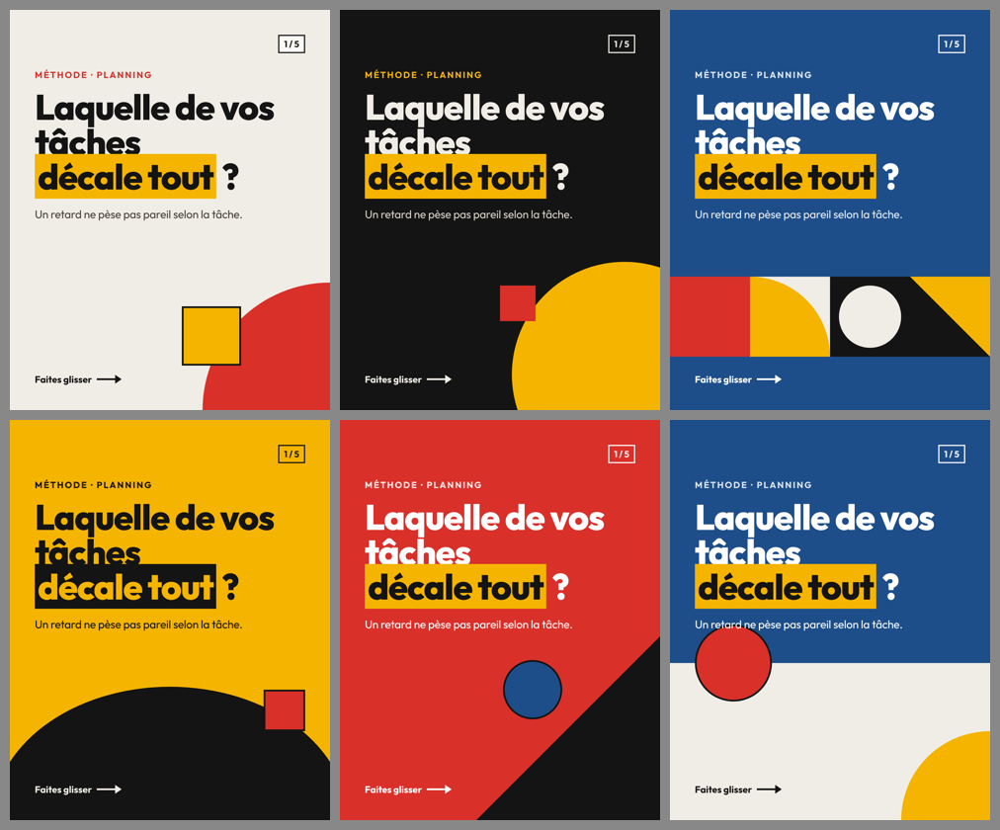

# Test des fonds et de la géométrie · Instagram

Ouvert le 20/11/2026 à la demande de Quentin. Non publié (`/docs/*` en 404).

## Problème

Les publications organiques plafonnent entre 25 et 51 vues (carrousels et posts), avec deux exceptions : les vidéos
de démonstration (125 et 106 vues). Toute la grille utilise le même fond papier et la même composition (formes en
coin, compteur « 1 / 5 »). Sur un fil, une publication ressemble donc à la précédente. **Question testée : changer de
fond et de géométrie, sans sortir de la charte, fait-il monter la portée organique ?**

## Constat de départ, corrigé

| Publication | Vues | Couverture | J'aime | Enreg. | Partages | Comm. | Abonnés gagnés | Remarque |
|---|---|---|---|---|---|---|---|---|
| Reel « Un tableur trouvé en ligne dépanne… » (13/11, 0:15, fond encre) | 1 024 | 876 | 7 | 0 | – | 0 | 1 | **sponsorisé** le 19/11 à 20:48 |

Le 20/11, une première analyse avait attribué ce score au fond noir et à l'accroche. Puis les statistiques ont montré
une publicité (« Les statistiques incluent les données de votre reel et de toute publicité »). Mais la remarque
d'IG-42 dans le planning Instagram, écrite le 16/11, soit **avant** la publicité, indique déjà **697 vues** pour ce Reel
publié à la main le 13/11. Conclusion retenue : la publicité explique le passage de 697 à 1 024 vues, pas les 697
premières. En organique, ce Reel reste environ 7 fois au-dessus des autres publications. La cause (format Reel, fond
encre, accroche en récit, premier Reel du compte) reste à démontrer. Le test ci-dessous ne vise que le fond.

**Règle du test : une publication sponsorisée est exclue de la comparaison.** Si une publication du test est
sponsorisée, on ne retient que ses chiffres organiques, quand Instagram les sépare. Sinon elle sort du test.

## Variantes

Même texte, même taille, même place du titre. Seuls le fond et la géométrie changent. Toutes les variantes restent
dans la charte (`../README.md`, section Charte) : cinq couleurs, Outfit 800, angles droits, formes Bauhaus, pas de
dégradé, texte blanc sur rouge et bleu, texte encre sur jaune.

| Code | Fond | Géométrie |
|---|---|---|
| A | papier | formes en coin : quart de cercle rouge et carré jaune (**référence**, le style actuel) |
| B | encre | grand cercle jaune qui sort du cadre, petit carré rouge |
| C | bleu | frise de quatre modules en pied : carré rouge, quart de cercle jaune, cercle papier, triangle encre |
| D | jaune | demi-cercle encre sur toute la largeur, carré rouge ; surlignage encre |
| E | rouge | grand triangle encre en diagonale, cercle bleu |
| F | deux plans | bandeau bleu en haut, papier en bas, cercle rouge à cheval sur la limite |

Source : `variantes.html` · rendu : `node docs/templates/communication/instagram/rendre.mjs tests-fonds/variantes.html`,
puis déplacer `png/test-fond-*.png` dans `tests-fonds/png/` · comparaison : `png/planche.png`.

## Protocole

1. **Une seule variable** : le fond et la géométrie de la couverture. On garde le format (carrousel de 5 vues), l'heure
   (19:00, publication principale, `../../HEURES.md`), le type de sujet et la légende type.
2. **Rotation** sur les 12 prochains carrousels : B, C, D, E, F, A, puis F, E, D, C, B, A. Chaque variante passe deux
   fois, une fois dans chaque moitié, pour limiter l'effet du jour et de la croissance du compte.
3. **Relevé à J+7** dans Statistiques : vues, couverture, **part de non-abonnés**, enregistrements, partages, visites du
   profil, abonnés gagnés. Noter aussi le nombre d'abonnés du compte le jour de la publication.
4. **Lecture** : la moyenne des deux passages d'une variante est comparée à celle de A. Avec deux points par variante,
   seul un écart supérieur à × 2, de même sens sur les deux passages, compte comme un signal. En dessous, la conclusion
   est « pas de différence mesurable ».
5. Si une variante l'emporte, on l'adopte en alternance avec A (pas en remplacement : la grille doit rester variée),
   puis on teste les Reels au format 1080 × 1920 avec le même code.

## Suivi

| # | Date | Publication | Variante | Sponsorisée | Abonnés du compte | Vues | Couverture | % non-abonnés | Enreg. | Partages | Visites profil | Abonnés gagnés |
|---|---|---|---|---|---|---|---|---|---|---|---|---|
| 0 | moyenne avant test | carrousels de la grille au 20/11 | A | non | – | 25 à 51 | – | – | – | – | – | – |
| 1 | 21/11 | IG-29 · Sur mesure · fiche d'arrivée | B | | | | | | | | | |
| 2 | 22/11 | IG-62 · Suivi des abonnements | C | | | | | | | | | |
| 3 | 23/11 | IG-07 · Livre recettes micro-entreprise | D | | | | | | | | | |
| 4 | 25/11 | IG-151 · Vivre sans voiture | E | | | | | | | | | |
| 5 | 26/11 | IG-08 · Budget commun | F | | | | | | | | | |
| 6 | 27/11 | IG-30 · Sur mesure · maintenance au compteur | A | | | | | | | | | |
| 7 | 28/11 | IG-09 · Planning Gantt | F | | | | | | | | | |
| 8 | 30/11 | IG-10 · Gestionnaire de tâches | E | | | | | | | | | |
| 9 | 04/12 | IG-12 · Circuit de visa | D | | | | | | | | | |
| 10 | 05/12 | IG-13 · Non-conformités | C | | | | | | | | | |
| 11 | 06/12 | IG-14 · CRM freelance | B | | | | | | | | | |
| 12 | 07/12 | IG-17 · Levée de réserves | A | | | | | | | | | |

## Journal

- **20/11/2026** : ouverture du test. Six variantes rendues.
- **20/11/2026** : affectation validée par Quentin. Les 10 couvertures B à F sont générées par
  `generer_couvertures.py` → `couvertures.html` → `rendre.mjs` (même texte que l'original, seuls fond et géométrie
  changent) et écrasent `instagram/png/IG-nn-<slug>-1.png`. Dans Drive (Images Instagram), elles sont déposées sous le
  même nom ; les anciennes sont renommées `…-1-ANCIEN-papier.png`, pas supprimées. Dans le planning, le premier ID de la
  colonne P est remplacé et une note « TEST DES FONDS » ajoutée en tête de la colonne M ; le texte alternatif de la vue 1
  d'IG-62 est corrigé (il décrivait le fond clair). IG-30 et IG-17 (A) gardent leur couverture. Vues 2 à 5, légendes et
  heures inchangées. Planche : `png/planche-12-carrousels.png`.
- Non fait : les diaporamas TikTok (`IG-nn-<slug>-tiktok.mp4`) éventuellement déjà déposés gardent l'ancienne
  couverture. TikTok n'entre pas dans la mesure.
